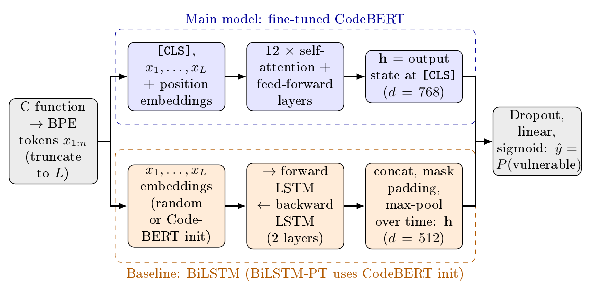

# Detecting Vulnerable C Functions: Fine-Tuned CodeBERT vs. BiLSTM

Kareem Rammah and Danny Leo.

## Introduction
We classify whether a single C function (from FFmpeg or QEMU; the Devign dataset in the CodeXGLUE split) is vulnerable.
- **Input:** the function's BPE token sequence (variable length, truncated to L = 512 tokens).
- **Output:** the probability that the function is vulnerable.
- **Models:** a BiLSTM trained from scratch (baseline) against CodeBERT fine-tuned end to end.
- **Main finding:** the BiLSTM (64.8% accuracy) and CodeBERT (65.3% at learning rate 2e-5, 62.3% at 3e-5) are within seed-to-seed variation of each other, so we find no clear benefit from pre-training. The learning rate moves CodeBERT more than the choice of model does. See the results and the data-artifact note below.

## Repository layout
```
src/            data.py (loading, dedupe, tokenization), models.py, train.py, analyze.py,
                eda.py, length_baseline.py, brace_artifact.py
report/         main.tex (the paper), architecture.png/.tex, eda.png, fig_curves.pdf
results/        table.md, all_runs.json (metrics + training history of every run),
                *_confident_errors.txt
run_all.sh      every command used for the experiments
requirements.txt
```
Data and model weights are not included (see Data).

## Model
- **Architecture figure** (the same figure as Figure 2 in the report; source in `report/architecture.tex`):

  

- **CodeBERT forward pass:** BPE tokens → `[CLS]` + tokens + `[SEP]` (at most 512 in total) → token + position embeddings with LayerNorm → 12 × (multi-head self-attention + feed-forward, each with a residual connection and LayerNorm) → final hidden state at `[CLS]` (768) → dropout 0.1 → linear → sigmoid.
- **BiLSTM forward pass:** the same tokens → learned embedding (256) → 2-layer bidirectional LSTM (256 per direction, dropout 0.3 between layers, packed padded sequences) → concatenated directions (512) → masked max-pool over time (padding ignored) → dropout 0.3 → linear → sigmoid.
- **Parameter counts** (from `results/all_runs.json`):
  - BiLSTM: 15,497,985 = embeddings 12,867,840 (50,265 × 256) + LSTM 2,629,632 (layer 1: 1,052,672; layer 2: 1,576,960) + output layer 513.
  - BiLSTM-PT (CodeBERT-initialised embeddings): 41,430,529 = embeddings 38,603,520 (50,265 × 768) + projection 196,864 (768 → 256) + LSTM 2,629,632 + output 513.
  - CodeBERT classifier: 124,646,401 = embeddings 39,000,576 (word 38,603,520 + position 394,752 + token-type 768 + LayerNorm 1,536) + 12 layers × 7,087,872 = 85,054,464 + pooler 590,592 + output layer 769. The pooler is loaded but never used, because we read the `[CLS]` state directly, so about 124.06M parameters are actually used. With only the top 4 layers fine-tuned, 28,942,849 parameters are trainable.
- **Examples from the test set** (CodeBERT, L = 512, learning rate 2e-5, seed 0):
  - **Success** (true label 1, predicted vulnerable with p = 1.000, 236 tokens):
    ```c
    VIOsPAPRDevice *vty_lookup(sPAPRMachineState *spapr, target_ulong reg)
    {
        VIOsPAPRDevice *sdev;
        sdev = spapr_vio_find_by_reg(spapr->vio_bus, reg);
        if (!sdev && reg == 0) {
            /* Hack for kernel early debug, which always specifies reg==0. ... */
            return spapr_vty_get_default(spapr->vio_bus);
        return sdev;
    ```
    The prediction is correct, but we do not read it as evidence of understanding. The text is missing its closing braces, and in this dataset about 5% of vulnerable functions (and almost no non-vulnerable ones) end without a closing brace. The model may have used that formatting artifact (see Data).
  - **Failure** (true label 0, predicted vulnerable with p = 0.994, 392 tokens; test index 756): `gen_tlbsx_440` from QEMU's PowerPC translator. It allocates a temporary (`tcg_temp_new()`), frees it (`tcg_temp_free(t0)`), returns early inside an `#if` guard, and calls low-level helpers. The model is most confident here, but the label is non-vulnerable. A plausible reason is that this low-level resource-handling style looks like vulnerable code to the model. Such functions are common in QEMU's CPU emulation code.

## Data
- **Source:** Devign (Zhou et al., 2019) as packaged in CodeXGLUE (Lu et al., 2021); the Hugging Face dataset `google/code_x_glue_cc_defect_detection`. The data is **not** included in this repository. It is downloaded automatically by `src/data.py`.
- **Summary statistics** (`python src/eda.py`):
  - 27,318 functions; train / validation / test = 21,854 / 2,732 / 2,732; vulnerable fraction 45.8% / 43.4% / 45.9%.
  - Token lengths (CodeBERT BPE, without special tokens, after deduplication): median 482, mean 1,114, 90th percentile 2,420, maximum 90,858; 48.1% exceed 512 tokens. Training medians are 443 (non-vulnerable) and 522 (vulnerable).
  - 10 test and 8 validation functions also occur in the training set; 21,796 of the 21,854 training functions are unique.
- **Formatting artifact** (`python src/brace_artifact.py`): 5.8% of vulnerable training functions end without a closing brace, against under 0.1% of non-vulnerable ones (5.2% and under 0.1% in test). In the test split, 65 functions (2.4%) lack a final brace, and all 65 are vulnerable. The three models classify them with 89–93% accuracy, against 62–65% on the rest, and excluding them lowers overall accuracy by 0.6–0.7 points. We kept these functions to stay comparable with published results.
- **Transformations:** whitespace-normalised exact-match deduplication of the training set, and removal of training functions that occur in validation or test (21,778 training functions remain). CodeBERT byte-level BPE tokenization for both models. Truncation to L tokens including `[CLS]` and `[SEP]` (first L tokens, or first and last L/2 for the head+tail ablation). Per-batch padding. No augmentation, comment stripping, or identifier renaming.
- **Split:** the fixed benchmark split.

## Training
- **Training curves:** `report/fig_curves.pdf` (training loss, validation F1, validation ROC-AUC; one line per seed).
- **Settings:** the checkpoint with the best validation F1 is evaluated once on the test split.
  - CodeBERT: AdamW, learning rate 2e-5, weight decay 0.01, 10% linear warm-up then linear decay, batch size 16, 5 epochs, dropout 0.1, gradient clipping 1.0, fp16.
  - BiLSTM: Adam, learning rate 1e-3, batch size 32, 10 epochs, dropout 0.3, gradient clipping 1.0.
- **Hyperparameter tuning:** only the learning rate, on seed 0, chosen by best validation F1.

  | Model | Learning rate | Best validation F1 | Best validation ROC-AUC |
  |---|---|---|---|
  | BiLSTM | 5e-4 | 0.609 | 0.738 |
  | BiLSTM | **1e-3** | **0.632** | 0.738 |
  | BiLSTM | 2e-3 | 0.616 | 0.737 |
  | CodeBERT | 1e-5 | 0.578 | 0.739 |
  | CodeBERT | 2e-5 | 0.618 | 0.739 |
  | CodeBERT | 3e-5 | **0.639** | 0.739 |

  For the BiLSTM the default won. For CodeBERT, 3e-5 had the highest validation F1, so we ran seeds 1 and 2 with it too and report both settings. On the test set 3e-5 was worse in accuracy and ROC-AUC. Selecting checkpoints by validation F1 at a fixed 0.5 threshold sometimes picked an under-trained epoch (for 3e-5 seed 1, epoch 1 with validation ROC-AUC 0.688, although epoch 3 reached 0.746), which probably explains it. The ablations used 2e-5. Batch size, dropout, and epochs were not tuned. Repeating the same configuration and seed gives slightly different results (best validation F1 0.566 and 0.578 for CodeBERT at 1e-5), because GPU kernels are not deterministic, so differences of about one point are noise.

## Results
- **Metrics:** accuracy, precision, recall, F1, and ROC-AUC on the test split at threshold 0.5. Accuracy is used for comparability with published work and because the classes are near-balanced. ROC-AUC does not depend on the threshold. Recall is the share of vulnerable functions that are caught.
- **Quantitative results** (test, %, mean ± population standard deviation over 3 seeds):

  | Model | Accuracy | Precision | Recall | F1 | ROC-AUC |
  |---|---|---|---|---|---|
  | Length-only logistic regression | 52.5 | 41.1 | 7.7 | 13.0 | 50.5 |
  | BiLSTM | 64.8 ± 0.5 | 61.6 ± 2.2 | 63.5 ± 6.8 | 62.2 ± 2.3 | 72.2 ± 0.6 |
  | CodeBERT, lr 2e-5 | 65.3 ± 1.8 | 64.0 ± 4.6 | 59.1 ± 8.2 | 60.8 ± 2.1 | 72.6 ± 1.3 |
  | CodeBERT, lr 3e-5 | 62.3 ± 2.4 | 57.7 ± 3.3 | 70.3 ± 5.8 | 63.1 ± 1.2 | 70.7 ± 2.2 |

  Ablations (seed 0; references: CodeBERT 62.7 accuracy / 70.7 ROC-AUC, BiLSTM 64.2 / 71.5):

  | Variant | Accuracy | ROC-AUC |
  |---|---|---|
  | CodeBERT L=256 | 62.4 | 70.4 |
  | CodeBERT L=128 | 61.5 | 68.4 |
  | CodeBERT first + last L/2 tokens | 66.1 | 74.0 |
  | CodeBERT top 4 layers fine-tuned | 64.4 | 70.3 |
  | BiLSTM first + last L/2 tokens | 64.0 | 72.3 |
  | BiLSTM-PT (CodeBERT embeddings) | 62.2 | 69.4 |

  Accuracy by function length (mean over 3 seeds): CodeBERT falls from 75.4% below 128 tokens to 57.2% above 2,000 tokens; the BiLSTM from 77.1% to 58.5%. The false-negative rate at threshold 0.5 is 30.0 / 49.6 / 43.1% for CodeBERT (lr 2e-5) and 29.1 / 35.1 / 45.5% for the BiLSTM, for seeds 0 / 1 / 2.
- **Qualitative results:** we read the 19 most confident CodeBERT errors on the test set (`results/codebert_confident_errors.txt`). Fourteen are false positives, mostly low-level QEMU CPU and device emulation code with pointer arithmetic, manual temporary allocation, inline assembly, or `#if` guards, often in an older coding style. Five are false negatives: short functions that look correct in isolation, so their labels probably reflect the surrounding commit. We also read the 16 most confident BiLSTM errors (`results/bilstm_confident_errors.txt`): ten false negatives and six false positives, the reverse mix. Three false negatives are shared with CodeBERT. The BiLSTM's other false negatives are short locking or API-wrapper functions whose defects depend on outside context; one (`check_checksum`) has its checksum comparison commented out. Its false positives are ordinary block-layer, migration, and codec functions, none of which overlaps with CodeBERT's.
- **Justification:** the BiLSTM and the better CodeBERT setting reach about 65% accuracy and 72–73% ROC-AUC. This is above the published CodeXGLUE numbers for this split (BiLSTM 59.4%, CodeBERT 62.1%; CodeBERT at 3e-5 only matches its published number) and far above a length-only classifier (52.5%), so they learn real signal. They are still weak detectors. They overfit within a few epochs, lose accuracy as functions get longer, and miss 29–50% of vulnerable functions at the default threshold, depending on the seed. A modest ceiling is plausible on a noisy, function-level, commit-derived benchmark, where graph-based methods reach only about 63–64%. The BiLSTM–CodeBERT difference is smaller than the variation between seeds and than the effect of the learning rate. We did not reproduce the published training setup, so differences in tokenizer, input length, pooling, or checkpoint selection may explain why we score higher. The formatting artifact explains at most about one point.

## Ethical Considerations
- **Missed vulnerabilities:** 29–50% of vulnerable functions are missed at the default threshold, depending on the seed. The risk is false reassurance, so this must not replace human review.
- **Dual use:** a model that ranks functions by likelihood of being vulnerable could also guide an attacker.
- **Data limits:** labels come from security-related commits and are noisy; both projects are maintained by experienced developers; the dataset contains a formatting artifact. Results may not transfer to other code.
- **Individuals:** flagged code is attributable to specific developers, so output must never be used to evaluate people.

This is a research baseline, not a deployable scanner.

## Authors
<!-- Placeholder based on the proposal's planned work division. Confirm that it matches who actually did what before submitting. -->
Kareem Rammah and Danny Leo worked as a team of two.

**Kareem Rammah**
- Repository setup, data loading, deduplication, tokenization, and the train/validation/test pipeline
- CodeBERT fine-tuning script and evaluation metrics
- BiLSTM and BiLSTM-PT training and hyperparameter tuning
- Three-seed runs, truncation ablation, layer-freezing ablation, and parameter counts
- Report: results, discussion, and limitations

**Danny Leo**
- BiLSTM baseline and length-only baseline implementation
- Full CodeBERT training and checkpointing
- Exploratory data analysis, README, and results tables
- Error analysis by function length, with success and failure examples
- Report: abstract, introduction, data, conclusion, related work, model architecture, ethics, and the final architecture figure

**Shared:** results tables, training curves, discussion draft, revisions based on the proposal feedback, and submission.

## How to run
```bash
git clone https://github.com/<your-username>/<repo-name>.git
cd <repo-name>
pip install -r requirements.txt      # on Google Colab, do not reinstall torch
export PYTHONPATH=src
python src/eda.py && python src/length_baseline.py
python src/train.py --model codebert --seed 0     # also: bilstm, bilstm_pt, --max_len, --strategy headtail, --train_top_k 4, --lr
python src/analyze.py
```
`run_all.sh` runs every experiment from the report. We ran everything on a single NVIDIA Tesla T4 GPU in Google Colab.
